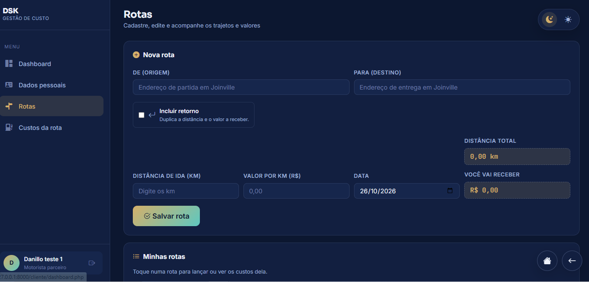
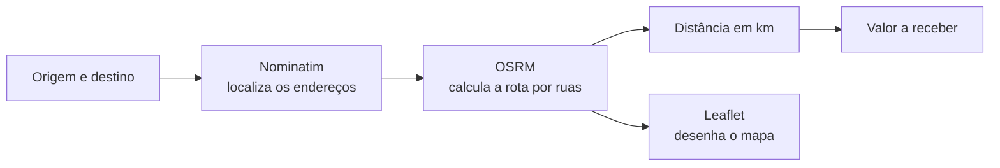

<p align="center">
  
</p>

<p align="center">
  
  
  
  
  
  
</p>

<p align="center">
  <b>Plataforma web para motoristas parceiros controlarem rotas, custos e lucro de cada entrega.</b>
</p>

---

## 📌 Sobre o projeto

O **DSK - Gestão de Custo** ajuda o motorista parceiro a saber, rota por rota, **quanto vai receber, quanto gastou e quanto sobrou**. O cliente cadastra o trajeto, a distância é calculada automaticamente pelo mapa, os custos são lançados por trecho e o sistema mostra o lucro real. O administrador acompanha os clientes e controla a mensalidade da plataforma.

## 📑 Sumário

- [Funcionalidades](#-funcionalidades)
- [Demonstração](#-demonstração)
- [Cálculo automático de distância](#-cálculo-automático-de-distância)
- [Tecnologias](#-tecnologias)
- [Como executar (XAMPP)](#-como-executar-xampp)
- [Acesso inicial](#-acesso-inicial)
- [Administração](#-administração)
- [Estrutura do projeto](#-estrutura-do-projeto)
- [Segurança](#-segurança)

## ✨ Funcionalidades

| Área | O que faz |
| --- | --- |
| 🗺️ **Rotas** | Cadastro, edição, consulta e exclusão de trajetos, com origem, destino, data e valor por km. |
| 📍 **Distância automática** | Calcula os km pelas ruas reais e desenha o trajeto no mapa (OpenStreetMap). |
| 🔁 **Ida e volta** | Uma opção dobra a distância, os custos e o valor a receber. |
| ⛽ **Custos da rota** | Lançamento de custos por trecho, com cálculo de lucro por rota. |
| 📊 **Dashboard** | Visão geral dos resultados do motorista. |
| 👤 **Dados pessoais** | O cliente mantém seu próprio cadastro atualizado. |
| 🛡️ **Painel administrativo** | Gestão de clientes (dados, senha e status da conta) e financeiro das mensalidades. |
| 🌗 **Tema claro e escuro** | Alternância de tema, lembrada pelo navegador. |

## 🎬 Demonstração

<p align="center">
  
  <br>
  <sub>Tela de cadastro de rotas do perfil cliente.</sub>
</p>

<!--
  GIFS DE DEMONSTRAÇÃO
  Grave a tela (ex.: ScreenToGif), salve em docs/img/ e remova os comentários abaixo:

<p align="center">
  
  <br><sub>Distância calculada automaticamente e trajeto no mapa.</sub>
</p>

<p align="center">
  
  <br><sub>Lançamento de custos e lucro da rota.</sub>
</p>
-->

## 📍 Cálculo automático de distância

Ao informar **origem** e **destino**, o sistema localiza os endereços, calcula a distância real por ruas e mostra o trajeto no mapa. O campo de km continua editável para ajustes manuais.



- O cálculo roda quando o motorista sai do campo, respeitando o limite de uso dos serviços gratuitos.
- Endereços sem cidade informada são procurados primeiro em **Joinville/SC**.
- A linha de status mostra o endereço encontrado, para conferência.
- Exige internet no navegador. Sem ela, os km podem ser digitados manualmente.

## 🧰 Tecnologias

**Back-end**
- PHP 8.2+ puro, sem framework
- PDO com MySQL 8 (consultas preparadas)
- Sessões nativas, hash de senha e proteção CSRF

**Front-end**
- HTML, CSS próprio (variáveis CSS, tema claro e escuro)
- Bootstrap 4.6.2, jQuery 3.6.0 e Bootstrap Icons 1.11.3
- JavaScript puro para as interações e cálculos
- Fontes Sora, Inter e JetBrains Mono

**Mapas**
- [OpenStreetMap](https://www.openstreetmap.org) (mapa base)
- [Nominatim](https://nominatim.org) (busca de endereços)
- [OSRM](https://project-osrm.org) (rotas e distâncias)
- [Leaflet](https://leafletjs.com) (exibição do mapa)

## 🚀 Como executar (XAMPP)

**Requisitos:** XAMPP instalado (PHP 8.2+ e MySQL) e um navegador com internet.

1. Abra o **XAMPP Control Panel**.
2. Clique em **Start** em **Apache** e em **MySQL**.
3. Abra o **CMD**, entre na pasta do projeto (`dsk`) e execute:

   ```bash
   C:\xampp\php\php.exe -S 127.0.0.1:8000 -t public
   ```

   Mantenha essa janela aberta enquanto usa o sistema.
4. Acesse **http://127.0.0.1:8000**.

### Primeira vez: criar o banco de dados

1. Com o MySQL iniciado, acesse **http://localhost/phpmyadmin** (ou use o MySQL Workbench).
2. Importe/execute somente o arquivo `db/init.sql`.

> ⚠️ O script apaga e recria **apenas** o banco `projetoindividual`, com todas as tabelas, o usuário do banco `dsk` e a conta de administrador. Outros bancos não são alterados, e os dados de teste desse banco são apagados.

Se os dados de conexão forem diferentes, defina `DB_HOST`, `DB_NAME`, `DB_USER` e `DB_PASS` no ambiente do PHP. Padrões: `127.0.0.1`, `projetoindividual`, `dsk` e `dsk123`.

## 🔑 Acesso inicial

| Perfil | E-mail | Senha |
| --- | --- | --- |
| Administrador | `eu sei dsk.danillo` | `1~~@~~1` |

Este é o único e-mail autorizado a usar o perfil de administrador. A senha fica armazenada no banco como hash, e o usuário MySQL `dsk` é separado do login da aplicação. Clientes se cadastram pela própria aplicação.

> 🔒 Credenciais acima são apenas para uso local e demonstração. **Altere-as antes de publicar o sistema em um servidor real.**

## 🛠️ Administração

O menu do administrador tem **Dashboard**, **Clientes** e **Financeiro**.

- **Clientes:** selecione um cadastro para editar dados pessoais e de acesso, redefinir a senha e controlar o status da conta. Cidade é salva no formato `CIDADE / UF`; e-mail e telefone não podem se repetir.
- **Financeiro:** controla somente a **mensalidade** que o cliente paga para usar a plataforma. O administrador gera a cobrança do mês e registra a baixa quando confirma o recebimento. Pix é uma forma de pagamento registrada, não uma chave armazenada.
- O sistema **não processa pagamentos** nem recebe valores de rotas.

## 🗂️ Estrutura do projeto

```text
dsk/
├── app/                  # bootstrap, conexão, autenticação e layout
│   └── lib/
├── db/
│   └── init.sql          # schema do banco de dados
├── docs/
│   └── img/              # banner, prints e GIFs do README
└── public/               # document root do servidor
    ├── admin/            # dashboard, clientes e financeiro
    ├── cliente/          # dashboard, dados pessoais, rotas e custos
    ├── assets/           # css, js e imagens
    ├── cadastro.php
    ├── index.php         # login
    └── logout.php
```

**Tabelas do banco:** `usuarios`, `clientes`, `rotas`, `custos_rota` e `mensalidades`.

## 🛡️ Segurança

- Consultas preparadas (PDO) contra SQL injection
- Senhas com `password_hash` / `password_verify`
- Token CSRF em todos os formulários
- Regeneração do ID de sessão no login
- Acesso separado por perfil (administrador e cliente)

---

<p align="center">
  <sub>DSK - Gestão de Custo · Mapas © colaboradores do <a href="https://www.openstreetmap.org/copyright">OpenStreetMap</a></sub>
</p>
